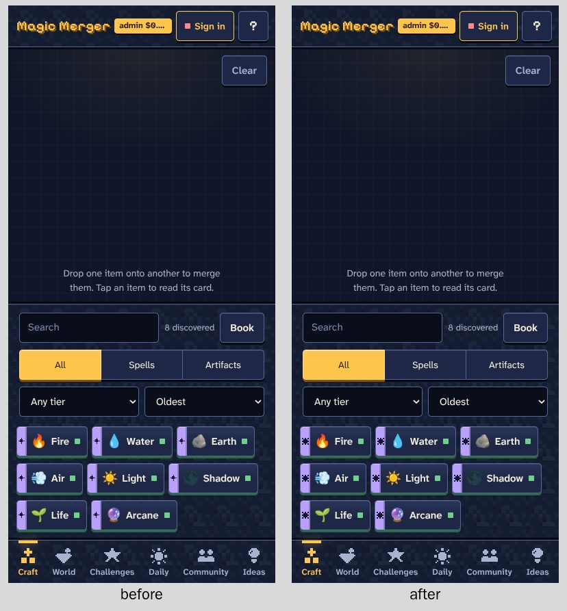
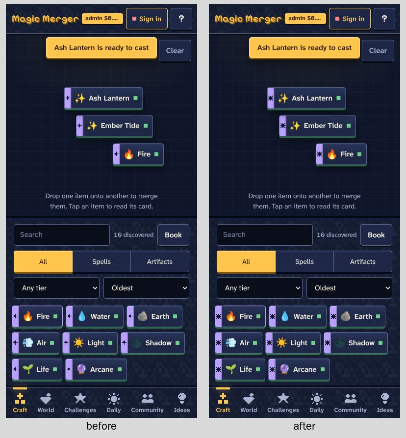
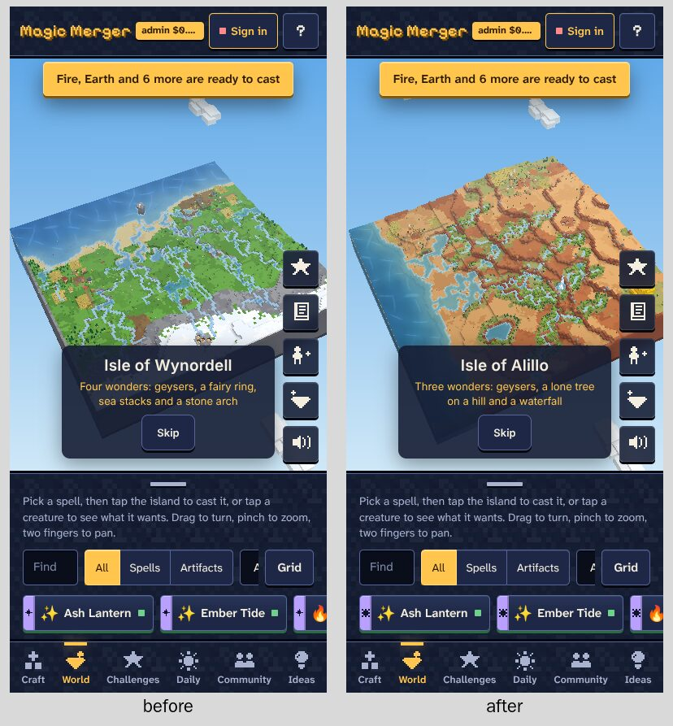
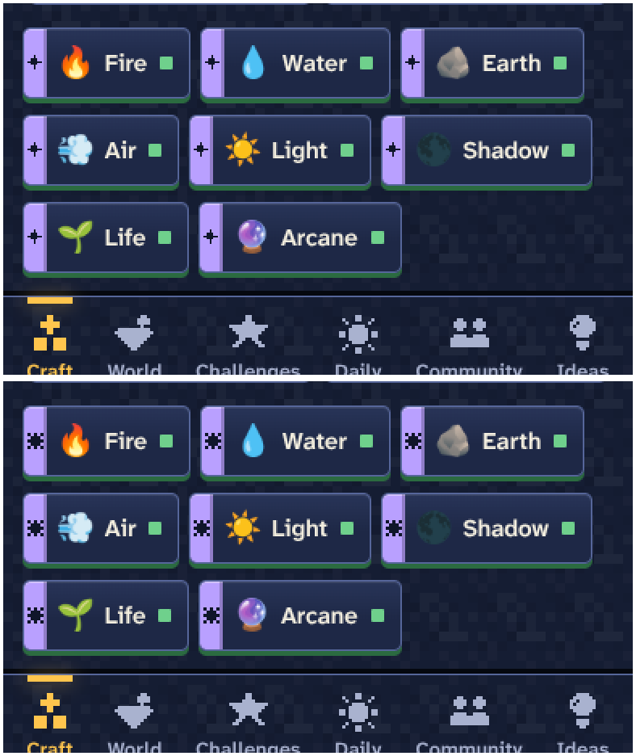

# The spell rune as a star: before and after

The spell rune redrawn as a star (it read as a plus).
Pull request: #82. Each image is the screen before (left) and after (right); a name ending in "after" has no before.

## Phone, 390 by 844

**Craft**

**Craft after merges, a toast**

**World and its drawer**

**The runes, zoomed 2x (top before, bottom after)**

